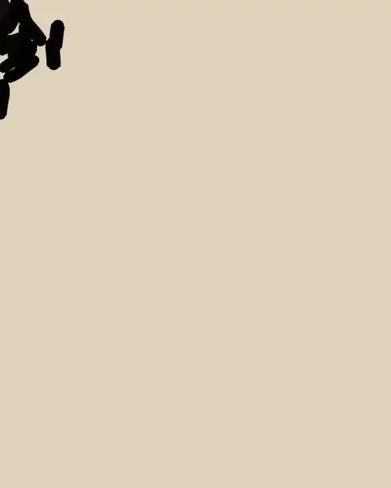
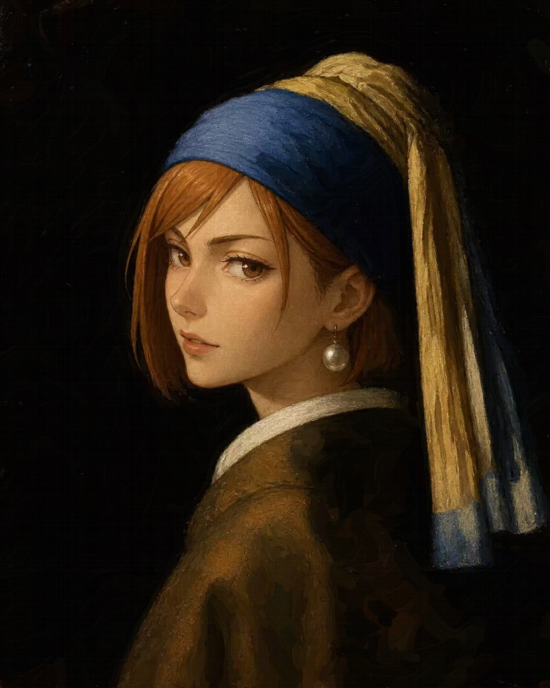
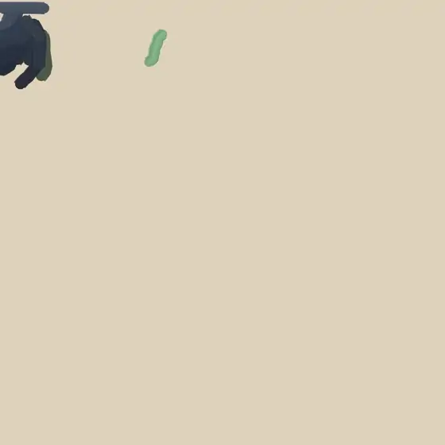
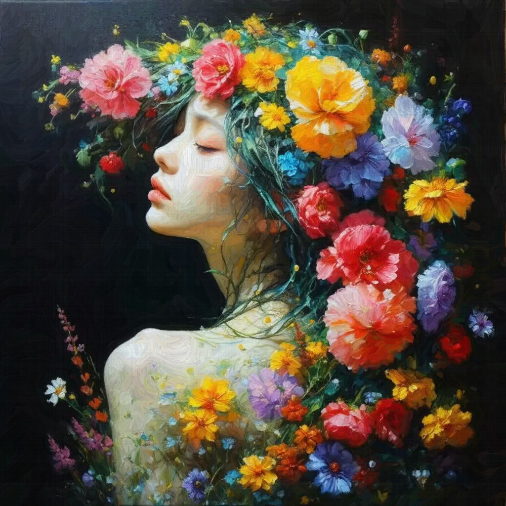
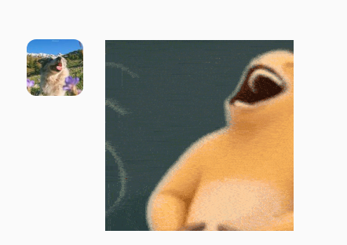
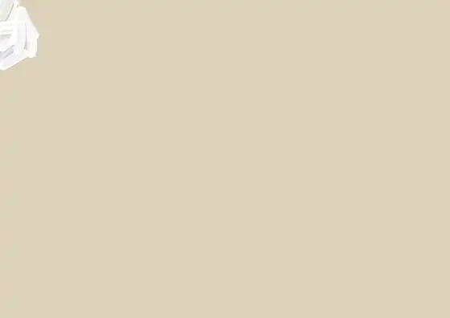
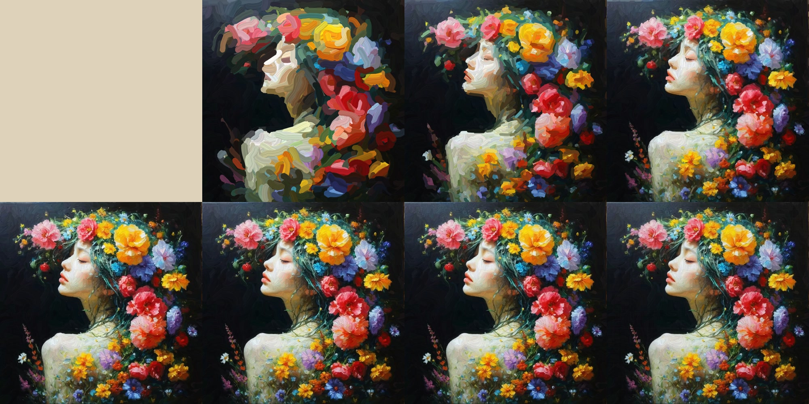
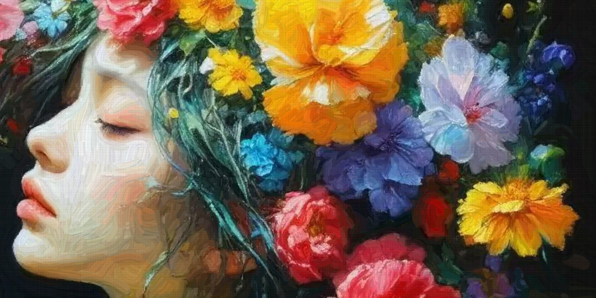

<h1 align="center">Stroke by Stroke · 一笔一画</h1>

<p align="center">
  An oil painter written in code. Give it a picture and watch it repaint the whole thing,<br>
  one brush stroke at a time.
</p>

<p align="center"><b>English</b> · <a href="README.zh-CN.md">简体中文</a></p>

<p align="center"><sub>Left: the reference · Middle: the painting in progress · Right: the finished painting</sub></p>

<p align="center">
  
  
  
</p>
<p align="center"><sub>477,127 strokes · <a href="assets/reference-1.mp4">full video (mp4)</a></sub></p>

<p align="center">
  
  
  
</p>
<p align="center"><sub>915,390 strokes · <a href="assets/reference-2.mp4">full video (mp4)</a></sub></p>

<p align="center">
  
  
  
</p>
<p align="center"><sub>182,624 strokes · <a href="assets/reference-3.mp4">full video (mp4)</a></sub></p>

<p align="center"><sub>The animations are shrunk and sped up 1.6×. The linked videos are full size at normal speed.</sub></p>

## What this is

There is no image model here and no style filter. The program writes a brush, and the brush does the painting.

The reference picture is only ever read as a palette and is never shown. The canvas starts blank. The brush then makes six passes over it, from a wide brush down to one about a pixel across, laying down a few hundred thousand strokes. Each stroke picks its colour from the reference, follows the contours of the picture, and lifts off when the colour underneath changes too much. Every frame of the process is saved.

<p align="center"></p>
<p align="center"><sub>Blank canvas, the canvas after each of the six passes, and the finished painting.</sub></p>

<p align="center"></p>
<p align="center"><sub>A close-up of the finished painting at twice the working size.</sub></p>

The idea comes from [this article](https://www.hubwiz.com/blog/fable52-code-painting-brush-strokes/) (in Chinese), and goes back to Aaron Hertzmann's 1998 paper *Painterly Rendering with Curved Brush Strokes of Multiple Sizes*.

## Quick start

You need Node 18.3 or newer and a local Chrome (Chromium and Edge also work).

```
npm install
node paint.mjs your-picture.jpg
```

To reproduce the examples above:

```
node paint.mjs reference-image/reference-1.jpg
node paint.mjs reference-image/reference-2.jpg
node paint.mjs reference-image/reference-3.png
```

JPG, PNG, WebP, GIF, AVIF and BMP are accepted, plus HEIC on macOS.

## What you get

Everything lands in `output/<picture name>/`:

| File | What it is |
|---|---|
| `painting-process.mp4` | The painting process at 30 fps, holding the last frame for 3 seconds |
| `frames/frame_0000.jpg …` | Every frame as an image. Frame 0 is the blank canvas |
| `final.png` / `final-1x.png` | The finished painting, at twice the working size and at the working size |
| `process-sheet.jpg` | Blank canvas, the end of each pass, and the finished painting side by side |
| `painting.html` | A single self-contained file. Double-click it and it paints itself, with pause, single-step and speed controls |
| `stats.json` | Strokes per pass, frame numbers, and the error against the reference |

The three examples above came out like this. The painting step took between 7 and 16 seconds each on an Apple M5 Pro, before video encoding.

| Example | Working size | Strokes | Frames | Mean absolute error vs. reference |
|---|---|---|---|---|
| `reference-1.jpg` | 1122×1402 | 477,127 | 526 | 1.52% |
| `reference-2.jpg` | 1024×1024 | 915,390 | 518 | 2.23% |
| `reference-3.png` | 800×565 (enlarged from 442×312) | 182,624 | 510 | 2.43% |

`reference-1` uses a hints file (see below). The other two are fully automatic.

## Options

| Option | Effect |
|---|---|
| `--out <dir>` | Output directory. Default: `output/<picture name>` |
| `--size <px>` | Length of the long side while painting. By default the original size is used, scaled into 800–1600 px if it falls outside that range |
| `--passes <1-6>` | Stop after this many passes. Fewer passes look looser. Default: all 6 |
| `--seed <int>` | Random seed. A different seed gives a different arrangement of strokes |
| `--config <file>` | Hints file for this picture. Default: `<picture name>.paint.json` next to the picture |
| `--no-config` | Ignore the `.paint.json` next to the picture |
| `--html-only` | Only write `painting.html`. No frames, no video |
| `--chrome <path>` | Where Chrome is. The `CHROME_PATH` environment variable also works |

## Telling the painter what matters (optional)

By default everything is automatic: where the fine brushes go depends only on how strong the contours are. If you want certain areas painted more finely, such as a face or the eyes, put a `.paint.json` with the same name next to the picture:

```json
{
  "center": [0.42, 0.44],
  "focus": [
    { "c": [0.33, 0.36], "r": [0.06, 0.05], "w": 1 }
  ],
  "glints": [
    { "c": [0.61, 0.52], "search": 0.02, "radius": 9, "alpha": 0.3 }
  ]
}
```

All coordinates are fractions of the picture's width and height, with `[0, 0]` at the top left. All three keys are optional.

- `center`: the centre of the subject, which decides where painting starts. If omitted, it is placed where the contours are densest.
- `focus`: areas to paint finely, as ellipses. `c` is the centre, `r` the two radii (both as fractions of the picture's width), and `w` a weight from 0 to 1.
- `glints`: highlights. The brightest point of the reference within `search` (a fraction of the width) of `c` gets a small glow at the end. `radius` is in pixels on a 1122 px wide canvas.

[`reference-image/reference-1.paint.json`](reference-image/reference-1.paint.json) is a complete example.

## How it paints

All of the painting logic is in [`src/painting.template.html`](src/painting.template.html). [`paint.mjs`](paint.mjs) only embeds the reference into it, drives Chrome frame by frame, and assembles the video.

1. **`setup`** decodes the reference into memory for colour lookups. It is never drawn to the screen.
2. **`buildFlow`** works out which way a stroke should run at every point. It uses the structure tensor to get the direction along a contour, not across it. Flat areas have no contours, so low-frequency noise supplies a direction there.
3. **`planPass`** compares the canvas with the reference before each pass and only places strokes where the two still differ. The finer the brush, the more it is restricted to contours and focus areas.
4. **`dab`** paints one stroke. It takes the colour under the starting point, walks a few short segments along the flow, and stops where the colour changes too much. Wide brushes also get bristle streaks and a lit and a shadowed edge, like thick paint.
5. **`stepFrame`** deals the ordered strokes out over the frames, then finishes with highlights, a vignette and a canvas weave.

Brush widths, stopping thresholds and placement thresholds for the six passes are in `CONFIG.passes` at the top of that file. The values were chosen on a 1122×1402 canvas and scale with the area of the picture.

## Limitations

- This is painting from a reference. Colour and composition come from the reference picture, not from the program.
- The last two passes use brushes one or two pixels wide, so the result ends up close to the original. For more visible brushwork, try `--passes 4` or `--passes 3`.
- Large flat areas, such as a clear sky or a plain background, show a swirling texture, because strokes there follow noise.
- With no hints file, smooth areas such as skin come out with coarser strokes than in the `reference-1` example.
- The parameters were tried on a handful of pictures and have not been tuned systematically.
- Small pictures are enlarged to 800 px on the long side before painting. A blurry original gives a blurry painting.
- If ffmpeg is reported missing, npm did not run the install script of `ffmpeg-static`. Approve it as npm suggests and reinstall, or install ffmpeg yourself. Without it only the video and the process sheet are skipped.

## About the example pictures

The pictures in `reference-image/` are included only as demo inputs. All rights to them remain with their original creators.

The media in `assets/` is generated from `output/` by `node scripts/readme-media.mjs`.
