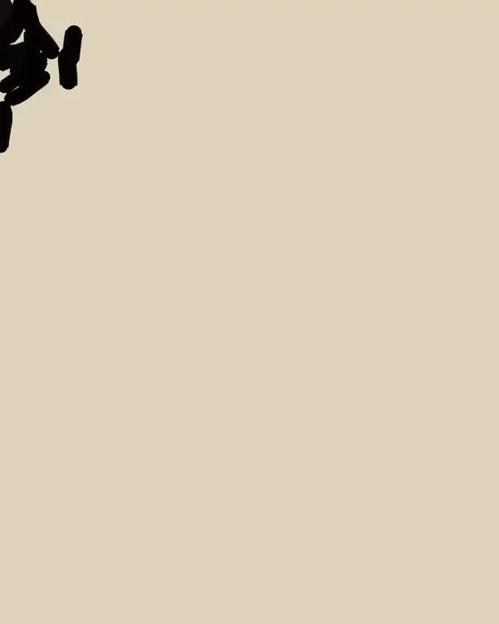
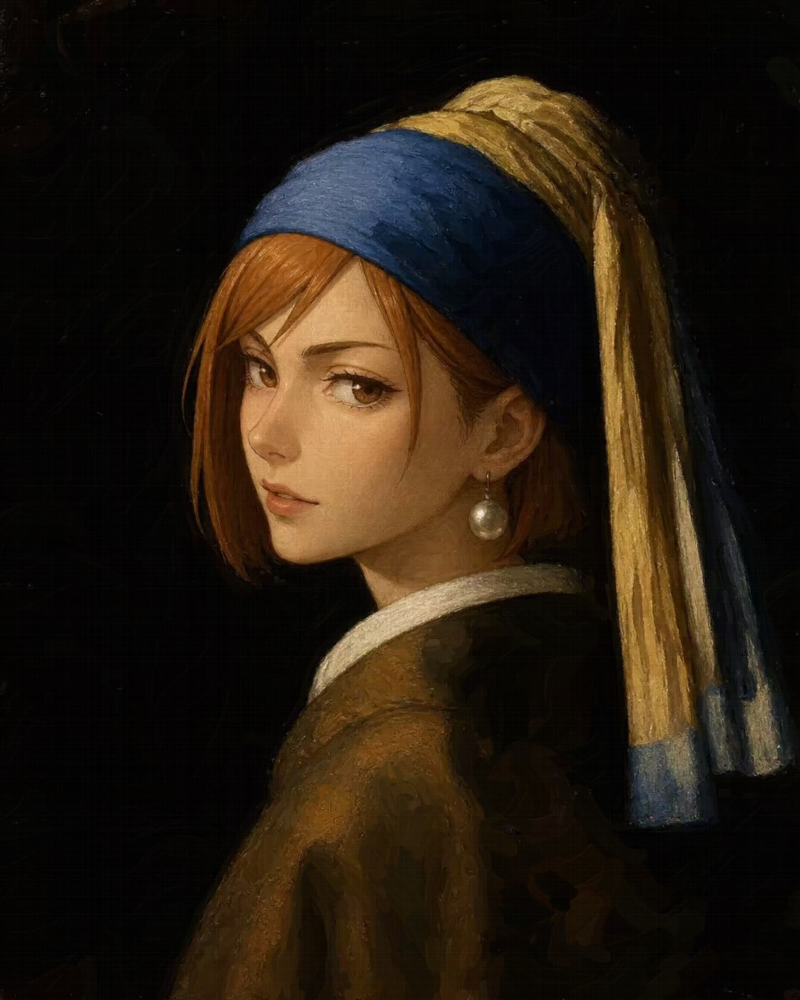
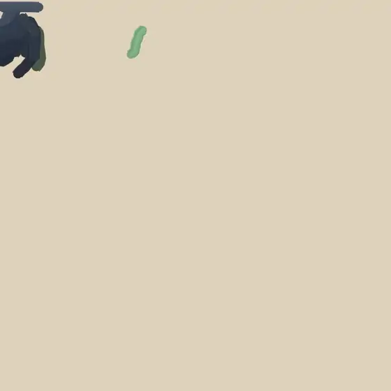
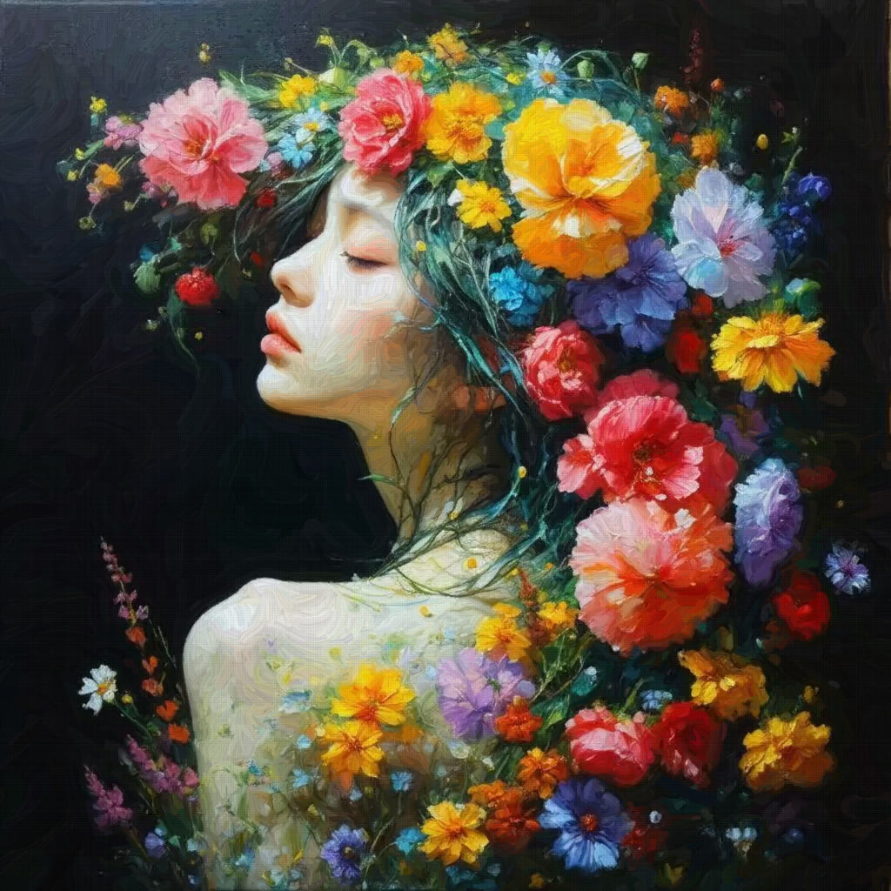
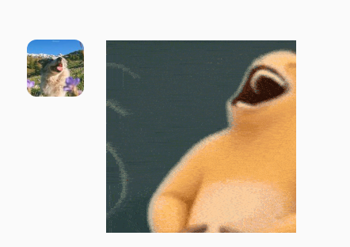
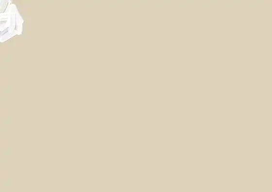
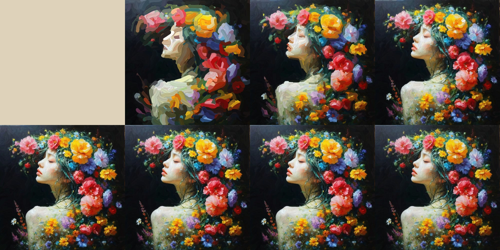
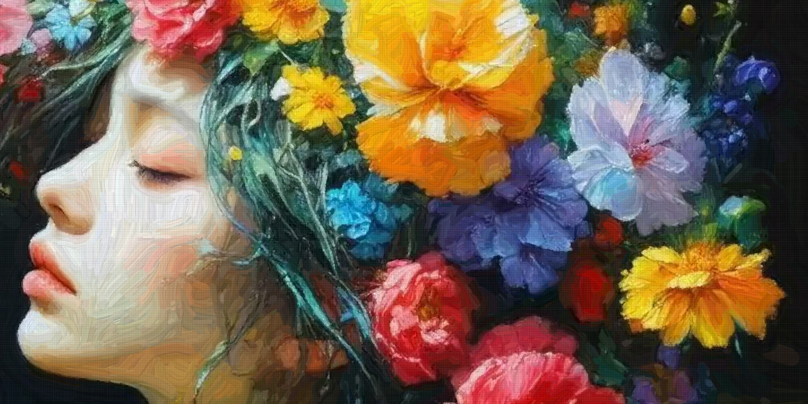

<h1 align="center">一笔一画 · Stroke by Stroke</h1>

<p align="center">
  一支用代码写成的油画笔。给它一张图，<br>
  看它一笔一笔把整幅画重画出来。
</p>

<p align="center"><a href="README.md">English</a> · <b>简体中文</b></p>

<p align="center"><sub>左：参考图 · 中：作画过程 · 右：画完的成图</sub></p>

<p align="center">
  
  
  
</p>
<p align="center"><sub>477,127 笔 · <a href="assets/reference-1.mp4">完整视频（mp4）</a></sub></p>

<p align="center">
  
  
  
</p>
<p align="center"><sub>915,390 笔 · <a href="assets/reference-2.mp4">完整视频（mp4）</a></sub></p>

<p align="center">
  
  
  
</p>
<p align="center"><sub>182,624 笔 · <a href="assets/reference-3.mp4">完整视频（mp4）</a></sub></p>

<p align="center"><sub>动图是缩小并加速 1.6 倍的预览，链接里的视频是原尺寸、正常速度。</sub></p>

## 这是什么

这里没有图像模型，也没有风格滤镜。程序写的是一支画笔，画是画笔画出来的。

参考图只被当作调色盘读取，从不显示。画布从空白开始，画笔从粗到细画六遍，从很宽的笔一直换到大约一个像素宽的笔，一共落下几十万笔。每一笔都从参考图上取色，沿着画面的轮廓走，颜色变化太大时就收笔。整个过程的每一帧都会存下来。

<p align="center"></p>
<p align="center"><sub>空白画布、六遍各自画完时的画面、成图。</sub></p>

<p align="center"></p>
<p align="center"><sub>成图的局部特写，取自两倍作画尺寸的成图。</sub></p>

思路来自[这篇文章](https://www.hubwiz.com/blog/fable52-code-painting-brush-strokes/)，更早的出处是 Aaron Hertzmann 1998 年的论文 *Painterly Rendering with Curved Brush Strokes of Multiple Sizes*。

## 快速开始

需要 Node 18.3 以上和本机安装的 Chrome（Chromium、Edge 也可以）。

```
npm install
node paint.mjs 你的图片.jpg
```

重现上面的三个例子：

```
node paint.mjs reference-image/reference-1.jpg
node paint.mjs reference-image/reference-2.jpg
node paint.mjs reference-image/reference-3.png
```

支持 JPG、PNG、WebP、GIF、AVIF、BMP，macOS 上还支持 HEIC。

## 会得到什么

结果都在 `output/<图片名>/` 里：

| 文件 | 内容 |
|---|---|
| `painting-process.mp4` | 作画过程视频，30 帧/秒，最后一帧停 3 秒 |
| `frames/frame_0000.jpg …` | 每一帧的图片，第 0 帧是空白画布 |
| `final.png` / `final-1x.png` | 成图，两倍作画尺寸和作画尺寸各一张 |
| `process-sheet.jpg` | 过程一览：空白画布、每一遍画完时、成图 |
| `painting.html` | 单个文件，双击打开就自动逐帧作画，可暂停、单帧步进、调速 |
| `stats.json` | 每一遍的笔数、帧号、与参考图的误差 |

上面三个例子的结果如下。在 Apple M5 Pro 上，作画这一步各用了 7 到 16 秒，不含视频编码。

| 例子 | 作画尺寸 | 笔数 | 帧数 | 与参考图的平均绝对误差 |
|---|---|---|---|---|
| `reference-1.jpg` | 1122×1402 | 477,127 | 526 | 1.52% |
| `reference-2.jpg` | 1024×1024 | 915,390 | 518 | 2.23% |
| `reference-3.png` | 800×565（由 442×312 放大） | 182,624 | 510 | 2.43% |

`reference-1` 用了一份提示文件（见下文），另外两张是全自动的。

## 选项

| 选项 | 作用 |
|---|---|
| `--out <目录>` | 输出目录，默认 `output/<图片名>` |
| `--size <像素>` | 作画时长边的像素数。默认用原图尺寸，超出 800–1600 时缩放到这个范围内 |
| `--passes <1-6>` | 只画前几遍。越少越写意，默认画满 6 遍 |
| `--seed <整数>` | 随机种子，换一个就是另一种笔触排布 |
| `--config <文件>` | 这张图的提示文件，默认读图片旁边的 `<图片名>.paint.json` |
| `--no-config` | 忽略图片旁边的 `.paint.json` |
| `--html-only` | 只生成 `painting.html`，不导出图片和视频 |
| `--chrome <路径>` | Chrome 的位置，也可以用环境变量 `CHROME_PATH` |

## 告诉画笔哪里重要（可选）

默认是全自动的：细笔落在哪里只看轮廓强弱。如果想让某些区域（比如人脸、眼睛）画得更细，在图片旁边放一个同名的 `.paint.json`：

```json
{
  "center": [0.42, 0.44],
  "focus": [
    { "c": [0.33, 0.36], "r": [0.06, 0.05], "w": 1 }
  ],
  "glints": [
    { "c": [0.61, 0.52], "search": 0.02, "radius": 9, "alpha": 0.3 }
  ]
}
```

坐标都是画幅宽高的比例，左上角是 `[0, 0]`。三项都可以省略。

- `center`：主体中心，决定从哪里画起。不给就取轮廓最集中的地方。
- `focus`：要画细的区域，椭圆。`c` 是中心，`r` 是两个半径（都按画幅宽度算），`w` 是权重，0 到 1。
- `glints`：高光。在 `c` 附近 `search`（按画幅宽度算）范围内找参考图最亮的一点，收尾时点一下辉光。`radius` 的单位是 1122 px 宽画幅上的像素。

[`reference-image/reference-1.paint.json`](reference-image/reference-1.paint.json) 是一个完整的例子。

## 它是怎么画的

作画逻辑全部在 [`src/painting.template.html`](src/painting.template.html) 里。[`paint.mjs`](paint.mjs) 只负责把参考图嵌进去、驱动 Chrome 逐帧截图和合成视频。

1. **`setup`**：把参考图解码进内存用来取色，从不画到屏幕上。
2. **`buildFlow`**：算出每个位置的笔触走向。用结构张量取沿着轮廓的方向，而不是横穿轮廓的方向；平坦处没有轮廓，改用低频噪声给方向。
3. **`planPass`**：每一遍开始前比较画布和参考图，只在还差得多的地方落笔。笔越细，越只落在轮廓和重点区域。
4. **`dab`**：画一笔。在落笔点取色，沿走向走几小段，颜色变化太大时收笔。粗笔还带笔毛丝缕，以及厚颜料那样的亮边和暗边。
5. **`stepFrame`**：把排好次序的笔触分到各帧里，最后加高光、暗角和画布纹理。

六遍的笔宽、收笔色差、落笔门槛都在该文件开头的 `CONFIG.passes` 里。数值是在 1122×1402 的画幅上定的，作画时按画幅面积等比缩放。

## 已知的限制

- 这是照着参考图画。颜色和构图都来自参考图，不是程序凭空创作的。
- 最后两遍的笔只有一两个像素宽，所以成图很接近原图。想要笔触更明显，可以用 `--passes 4` 或 `--passes 3`。
- 大片平坦的区域（晴朗的天空、纯色背景）会出现打旋的纹理，因为那里的笔触跟着噪声走。
- 不给提示文件时，皮肤这类平滑区域的笔触会比 `reference-1` 这个例子粗。
- 参数只在少数几张图上试过，没有系统地调过。
- 小图会先放大到长边 800 px 再画。原图模糊，成图也模糊。
- 如果提示找不到 ffmpeg，说明 npm 没有运行 `ffmpeg-static` 的安装脚本。按 npm 的提示批准后重装，或者自己装一个 ffmpeg。缺了它只会少视频和过程一览图。

## 关于示例图片

`reference-image/` 里的图片只作为演示输入收录，其权利归原作者所有。

`assets/` 里的素材由 `node scripts/readme-media.mjs` 从 `output/` 生成。
